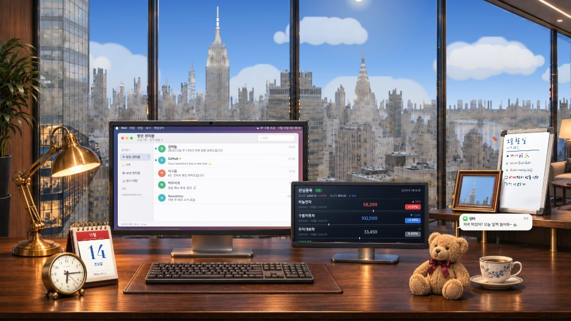

# 위젯 품은 움직이는 배경화면 · Moving Wallpaper with Widgets

> **Turn any image into a personalized, animated macOS desktop with AI.**<br>
> **원하는 이미지 한 장을 AI와 함께 나만의 움직이는 macOS 배경화면으로 바꿔보세요.**

This repository is not just one finished wallpaper. It is a working example and an AI-customizable starter kit: bring any scene—your room, a cozy café, a seaside cabin, a spaceship—and ask a coding AI to place the widgets and animations you want inside it.

이 저장소는 완성된 배경화면 하나만을 위한 프로젝트가 아닙니다. 맨해튼 펜트하우스는 실제로 동작하는 예제이자 AI 제작용 스타터입니다. 자신의 방, 카페, 바닷가 오두막, 우주선 등 원하는 장면을 준비하고 코딩 AI에게 필요한 위젯과 움직임을 말하면 누구나 자신만의 살아 있는 데스크톱을 만들 수 있습니다.

## The key idea · 핵심 아이디어

1. **Bring any image · 원하는 이미지 준비**<br>
   Generate a scene with an image AI, use your own artwork, or start from a photo.<br>
   이미지 생성 AI로 장면을 만들거나 자신의 그림·사진을 준비합니다.
2. **Describe what you want · 원하는 기능 설명**<br>
   Ask a coding AI for weather, clocks, calendars, stocks, mail, photos, music, system status, or entirely new interactions.<br>
   날씨·시계·일정·주식·메일·사진·음악·시스템 상태 등 원하는 기능을 코딩 AI에게 말합니다.
3. **Let AI adapt the starter · AI로 장면 맞춤 제작**<br>
   The AI can separate layers, locate widget surfaces, apply perspective transforms, connect data, and add animation using this repository as a working reference.<br>
   AI가 이 저장소를 참고해 레이어 분리, 위젯 위치 측정, 원근 변환, 데이터 연결과 애니메이션을 구현합니다.
4. **Run it with Plash · Plash로 실행**<br>
   Open the local page in [Plash](https://sindresorhus.com/plash) and use your creation as a live macOS wallpaper.<br>
   완성된 로컬 페이지를 [Plash](https://sindresorhus.com/plash)에 등록하면 나만의 macOS 라이브 배경화면이 됩니다.

**The Manhattan penthouse below is one example—not a limitation.**<br>
**아래 맨해튼 펜트하우스는 하나의 완성 예제일 뿐, 만들 수 있는 장면의 한계가 아닙니다.**

[Plash](https://sindresorhus.com/plash)로 띄우는 macOS 라이브 바탕화면입니다. 맨해튼 펜트하우스 책상 장면에서 창밖 하늘과 빌딩이 **실제 날씨·시간·계절**에 맞춰 바뀌고, 책상 위 소품에는 **실시간 데이터**가 표시됩니다.


<sub>데모 화면은 `?demo=1` 샘플 데이터로 촬영했습니다. 종목·메일·일정은 모두 가짜입니다.</sub>

| 낮 · 구름 조금 | 노을 |
|---|---|
|  |  |
| **맑은 밤** | **눈 오는 겨울 아침** |
|  |  |

---

## 무엇이 움직이나

| 소품 | 보여주는 것 | 데이터 출처 | 갱신 |
|---|---|---|---|
| 🌆 창밖 풍경 | 하늘색, 해·달(위상 포함)·별, 구름, 비·눈·안개·번개, 봄 꽃잎·가을 낙엽, 낮/밤 빌딩 | Open-Meteo (실패 시 wttr.in) + 태양 위치 계산 | 10분 (화면은 2초마다 보간) |
| 🪟 유리창 | 빗방울이 맺히고, 멈칫거리며 흘러내리고, 자국이 남음 | 날씨가 비·이슬비·뇌우일 때 | 실시간 |
| ⏰ 탁상시계 | 아날로그 시계 (초침 째깍) | 시스템 시각 | 1초 |
| 📅 탁상 달력 | 날짜·요일 + 다음 일정 | Mac 캘린더 (EventKit) | 5분 |
| 📝 화이트보드 | 오늘 일정 + 미리 알림을 손글씨로 | Mac 캘린더·미리 알림 | 5분 |
| 📈 보조 모니터 | 관심 종목 현재가·등락률·당일 범위, 코스피/코스닥, **업데이트 시간** | 네이버 증권 | 1분 |
| ✉️ 메인 모니터 | 오늘 받은 메일 (보낸 사람·제목·시각·읽음 여부) | IMAP | 3분 |
| 🖼️ 액자 | 지정한 폴더의 랜덤 사진 (비율 그대로, 잘리지 않게) | 로컬 폴더 | 1시간 |
| 🧸 곰인형 말풍선 | 방금 받은 iMessage (연락처 이름으로 표시) | Messages 데이터베이스 | 15초 |
| ☕ 그 밖에 | 커피 김, 낮에 들어오는 창빛, 모니터 빛 반사, 새벽엔 곰인형 zzZ | — | — |

리소스: 실측 기준 CPU 약 10~15%(코어 1개 기준, 전체의 1~2%), 메모리 약 300MB (Plash 포함).

---

## 설치와 실행

요구 사항: macOS 14+, Node.js 22.5+ (`brew install node`), Xcode Command Line Tools(캘린더 도우미 컴파일용), Plash

```bash
git clone https://github.com/jakalee/Moving-wallpaper-with-widgets.git
cd Moving-wallpaper-with-widgets
npm install
cp config.example.json config.json   # 메일 계정·사진 폴더·종목·위치 수정
npm start                            # → http://localhost:8777
```

Plash 메뉴 → *Add Website* → `http://localhost:8777`

로그인할 때 자동 실행: `npm run autostart` (LaunchAgent 등록, 로그는 `.cache/server.log`)

### 처음 설정

1. **메일 비밀번호** — 파일에 저장하지 않고 macOS 키체인에 넣습니다.
   ```bash
   npm run mail-setup
   ```
2. **캘린더/미리 알림** — 처음 실행 시 macOS 권한 창에서 허용.
3. **iMessage** — 시스템 설정 › 개인정보 보호 및 보안 › **전체 디스크 접근 권한**에 서버를 실행하는 앱(터미널 또는 `/opt/homebrew/bin/node`)을 추가.
4. **사진 폴더 / 종목 / 위치 / 메일 서버** — `config.json`에서 수정 (`photoDir`, `stocks`, `location`, `mail`). 메일플러그처럼 `AUTHENTICATE`를 지원하지 않는 서버는 `mail.loginMethod`를 `LOGIN`으로 둡니다.

### 미리보기 옵션

- `?debug=1` — 날씨·시각·월을 바꿔보는 패널
- `?weather=snow&hour=21&month=12` — 특정 상황 고정 (`clear` `partly` `cloudy` `overcast` `drizzle` `rain` `storm` `snow` `sleet` `fog`)
- `?demo=1` — 개인 데이터 대신 샘플 데이터 (스크린샷용)
- `?view=x,y,width` — 특정 영역 확대 (원본 1672×941 px 기준)

---

## 어떻게 동작하나

장면은 원본 그림(1672×941 px)을 기준으로 여러 겹을 쌓아 만듭니다. 화면 크기가 달라도 비율을 유지한 채 꽉 차게(cover) 확대됩니다.

```
맨 위   ┌ 말풍선 · 커피 김 · 번개 섬광 · 실내 조명/모니터 빛
        ├ foreground-clean.png   ← 방·책상·소품 (창문과 소품 화면 자리가 투명하게 뚫려 있음)
        ├ 소품 화면들 (HTML)     ← 시계·달력·모니터·액자·화이트보드. 구멍 모양에 맞춰 원근 변환
        ├ 유리창 빗방울 (canvas)
        ├ 창밖 날씨 (canvas)     ← 비·눈·안개·꽃잎
        ├ city-day / city-night  ← 하늘을 지운 빌딩. 해 고도에 따라 낮↔밤을 섞음
맨 아래 └ 하늘 (canvas)          ← 그라데이션·해·달·별·구름 (빌딩 뒤로 지나감)
```

- **소품 자리 맞추기** — 전경 그림의 투명 구멍을 픽셀 단위로 측정해 꼭짓점 4개를 얻고, 각 소품 HTML을 그 사각형에 `matrix3d` 원근 변환으로 붙입니다. 그래서 비스듬한 화이트보드·달력에도 글씨가 면을 따라 써집니다.
- **하늘 교체** — 원래 그림의 노을 하늘을 지운 빌딩 레이어(`sky-mask.png`로 분리)를 만들고, 하늘은 캔버스로 직접 그립니다. 낮 버전 빌딩은 불 켜진 창을 끄고 색을 보정해 미리 만들어 둡니다.
- **데이터** — `server.js`(Node)가 날씨·증권·메일·캘린더·사진·iMessage를 모아 `/api/*`로 내주고, 페이지가 주기적으로 가져갑니다. 비밀번호는 키체인에서만 읽습니다.

---

## AI로 직접 만드는 방법

이 프로젝트는 **이미지 생성 AI**로 장면을 그리고, **코딩 AI**(Claude Code)로 레이어 분리와 위젯·애니메이션을 만들었습니다. 다른 장면(카페, 서재, 바닷가 오두막 등)으로도 똑같이 만들 수 있습니다.

### 1단계 — 장면 그림 생성 (ChatGPT, Midjourney 등)

핵심은 **위젯이 들어갈 화면 자리를 마젠타(#FF00FF)로 칠해 달라고** 하는 것입니다. 나중에 그 색만 투명하게 뚫으면 위젯 자리가 됩니다.

```text
2D 애니메이션 풍의 고층 펜트하우스 서재, 16:9 가로 구도.
큰 통유리창 너머로 맨해튼 야경과 강이 보임.
책상 위에: 큰 모니터, 작은 보조 모니터, 원형 탁상시계, 스프링 탁상 달력,
작은 사진 액자, 이젤형 화이트보드, 작은 곰인형, 커피잔, 황동 스탠드.
모니터·시계 문자판·달력 종이·액자 사진·화이트보드 면은
글자나 무늬 없이 단색 마젠타(#FF00FF)로 칠해줘.
```

팁
- 위젯 자리는 **정면에 가깝게**, 너무 작지 않게 (시계 문자판 지름 100px 이상)
- 창밖은 나중에 하늘을 지우기 쉽게 **스카이라인이 또렷한 노을/저녁** 장면이 좋습니다
- 해상도는 최소 1600px 폭

### 2단계 — 두 장으로 나누기

| 파일 | 내용 | 만드는 법 |
|---|---|---|
| `foreground.png` | 방 전체. **창문 유리 영역과 마젠타 자리는 투명** | 이미지 편집기에서 마젠타를 색상 선택 → 삭제, 창문 영역도 선택해 삭제 |
| `city.png` | 창문 너머 풍경만 (나머지는 투명) | 원본에서 창문 영역만 남김 |

AI에게 맡겨도 됩니다: *"이 그림에서 마젠타 영역과 창문 유리 영역을 투명하게 만든 PNG와, 창문 영역만 남긴 PNG를 만들어줘"*

### 3단계 — 코딩 AI에게 맡기기

두 PNG를 폴더에 넣고 [Claude Code](https://claude.com/claude-code)에 이렇게 요청했습니다(실제로 쓴 요청을 정리한 것).

```text
Plash 앱으로 쓸 액티브 바탕화면을 만들어줘.
foreground.png는 방(투명한 구멍 = 위젯 자리와 창문), city.png는 창밖 풍경이야.

- 구멍 위치를 픽셀로 측정해서 위젯을 정확히 맞춰줘 (비스듬한 면은 원근 변환)
- 탁상시계: 실제 시각 / 탁상 달력: Mac 캘린더 연동
- 보조 모니터: 네이버 증권 (삼성증권, 기아, 에스엘) 현재가·등락률, "업데이트 시간" 표시
- 메인 모니터: 오늘 온 메일 (IMAP, 비밀번호는 키체인)
- 액자: 지정 폴더 랜덤 사진 1시간마다 / 화이트보드: 오늘 할 일·일정
- 곰인형: iMessage 알림을 말풍선으로
- 창밖은 현재 날씨·계절·낮밤에 맞춰 10분마다 바뀌게, 비 오면 창문에 빗물이 흐르게
- 2D 애니메이션 풍으로 최대한 멋지게
```

AI가 해준 일
1. 투명 구멍을 분석해 위젯별 꼭짓점 좌표 측정 → 원근 변환으로 배치
2. 창밖 그림에서 하늘 자동 분리(`helpers/sky.py`), 낮 버전 빌딩 생성(`helpers/day.py`)
3. 구멍 가장자리에 남은 분홍 테두리 제거 (`foreground-clean.png`)
4. 하늘·구름·비·눈·번개·빗방울 애니메이션 (canvas)
5. 데이터 서버(Node) + Mac 캘린더용 Swift 도우미 + 자동 실행 설정

### 4단계 — 다듬기

`?debug=1`로 날씨·시간을 바꿔 보며 "구름이 너무 밝다", "액자 사진이 잘린다"처럼 눈에 보이는 대로 말하면 AI가 고쳐 줍니다. 이 README의 GIF도 AI가 만든 촬영 스크립트로 찍었습니다 (`npm run demo-gif`, Chrome·ffmpeg 필요).

### 내 장면으로 바꿀 때 고칠 곳

- `app.js`의 `QUADS`(비스듬한 소품 꼭짓점)와 `style.css`의 `.monitor` `.monitor2` `.clock` 위치
- `helpers/sky.py`의 하늘 판별 기준(하늘이 끝나는 높이, 빌딩이 없는 x 범위)
- `#scene`의 크기 1672×941 → 내 그림 크기

---

## 파일

- `server.js` 데이터 서버 · `app.js` 장면/애니메이션 · `style.css` · `index.html`
- `city-night.png` / `city-day.png` / `sky-mask.png` — `city.png`에서 하늘을 분리하고 낮 버전을 만든 레이어 (`python3 helpers/sky.py <미리보기폴더>` → `python3 helpers/day.py <미리보기폴더>`, Pillow·NumPy·SciPy 필요)
- `foreground-clean.png` — `foreground.png`에서 구멍 가장자리 분홍 테두리를 제거한 버전
- `helpers/eventkit.swift` — 캘린더·미리 알림을 읽는 Swift 도우미 (서버가 처음 실행할 때 자동 컴파일)
- `scripts/` — 메일 비밀번호 저장, 자동 실행 등록, 데모 GIF 촬영
- `docs/` — README용 GIF·스크린샷
